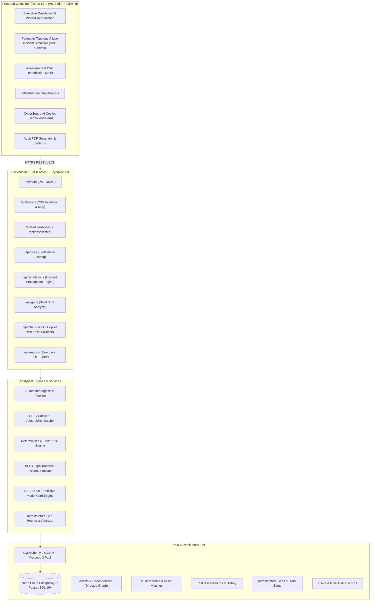
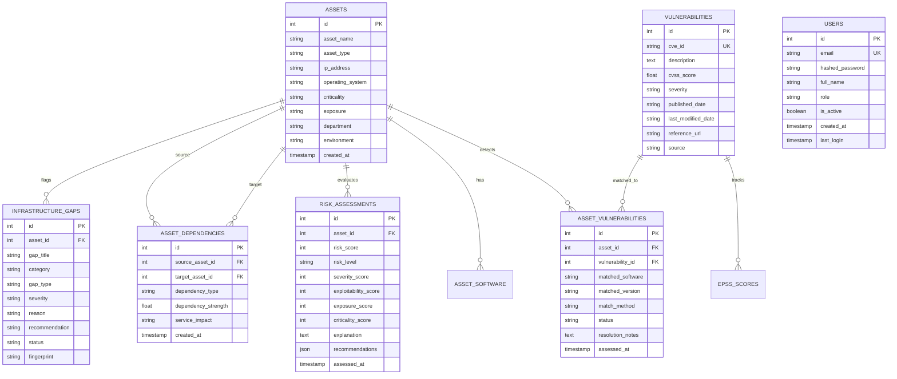

# CYBERSENTRA — Comprehensive System Architecture & Engineering Blueprint

**Platform**: CyberSentra (Enterprise Critical Infrastructure Cyber-Risk Prediction, Prioritisation, and Incident Simulation Platform)  
**Version**: 5.2.0 Production  
**Target Environments**: Healthcare & Clinical Enclaves, Power Grid & Utilities, Rail & Transit Signaling, Smart City Mesh, Enterprise Networks  

---

## 1. Executive Overview & Problem Statement

Modern critical infrastructure (energy, clinical hospital systems, municipal water, and transport networks) cannot rely on traditional commercial vulnerability scanners. Generic IT vulnerability scanning tools often:
1. **Disrupt operational continuity**: Aggressive active network scanning trips sensitive medical telemetry devices and legacy Programmable Logic Controllers (PLCs).
2. **Produce alert fatigue**: Flooding security operations teams with raw CVSS scores that lack operational criticality context.
3. **Ignore dependency cascades**: A CVSS 7.2 flaw on an active Active Directory gateway or Core SCADA Router can be far more catastrophic than a CVSS 9.8 flaw on an isolated airgapped test server.

**CyberSentra** solves this by establishing a **passive, predictive, context-aware cybersecurity intelligence platform**. It integrates:
- Deterministic multi-factor risk scoring (Vulnerability Severity + Threat Exploitability + Network Exposure + Operational Criticality).
- Machine learning threat prediction incorporating First.org **EPSS (Exploit Prediction Scoring System)**.
- Live graph-based **incident impact simulation** that models lateral movement, ransomware infection spread, and cascading dependency collapse without touching live physical devices.
- Automated ingestion with zero-touch pipeline activation.
- Integrated AI Copilot advisory for actionable executive mitigation playbooks.

---

## 2. End-to-End System Architecture



---

## 3. Core Subsystems & Analytical Engines

### 3.1. Deterministic Multi-Factor Risk Scoring Engine
Rather than relying purely on external CVSS ratings, CyberSentra implements a multi-dimensional weighted formulation:

$$\text{Risk Score} = \min\left(100, \max\left(5, \text{round}\left(0.40 \cdot S + 0.20 \cdot E + 0.20 \cdot X + 0.20 \cdot C\right)\right)\right)$$

| Dimension | Weight | Definition & Metrics |
| :--- | :---: | :--- |
| **Vulnerability Severity ($S$)** | 40% | Maximum CVSS score among active detected CVEs scaled to 0–100 ($CVSS \times 10$). |
| **Threat Exploitability ($E$)** | 20% | First.org EPSS score, known weaponization flags, and remote execution feasibility. |
| **Network Exposure ($X$)** | 20% | Attack surface accessibility: **External / DMZ** = 100, **Internal Enclave** = 35, **Isolated / Air-Gapped** = 10. |
| **Operational Criticality ($C$)** | 20% | Mission criticality of the host: **Critical** (Life-support, Substation PLC) = 100, **High** = 75, **Medium** = 50, **Low** = 25. |

#### Risk Tier Stratification
- **Critical Risk**: Score $\ge 80$ (Immediate emergency containment required)
- **High Risk**: $60 \le \text{Score} < 80$ (Prioritized patching window $\le 48\text{h}$)
- **Medium Risk**: $30 \le \text{Score} < 60$ (Scheduled maintenance cycle)
- **Low Risk**: $\text{Score} < 30$ (Routine audit monitoring)

---

### 3.2. Live Infrastructure Incident Propagation Simulator
The incident simulator enables operators to stress-test their perimeter against severe cyber events **without executing destructive exploits**.

#### Graph Model
- The network is modeled as a directed graph $G = (V, E)$, where vertices $V$ are infrastructure assets and directed edges $E$ represent functional dependencies ($u \to v$ denotes that system $v$ depends on system $u$).
- Edge properties include `dependency_type` (`authenticates`, `routes_traffic`, `persists_to`, `controls`), `dependency_strength` ($0.0 \dots 1.0$), and `service_impact`.

#### Supported Incident Archetypes
1. **Asset Compromise (`asset_compromise`)**:
   - Models adversary Initial Access and Lateral Movement (RCE/Credential Dumping).
   - Traversal expands downstream along functional dependencies and laterally across shared communication meshes (where `dependency_strength` $\ge 0.65$).
2. **Ransomware Impact (`ransomware`)**:
   - Models automated worm-like cryptoviral propagation across accessible subnets.
   - Infects direct dependencies and peer hosts sharing broadcast domains.
3. **Service Outage (`service_outage`)**:
   - Models cascading availability collapse.
   - Traversal strictly obeys downstream dependencies ($u \text{ offline} \implies v \text{ loses service}$).
4. **Network Isolation (`network_isolation`)**:
   - Models zero-trust containment perimeter. Limits propagation to immediate depth-1 boundary.

#### Simulation Traversal Algorithm
```
Algorithm: Deterministic Incident Traversal (BFS)
Input: Graph G = (V, E), Initial Asset ID root, Scenario Type scenario, Severity sev
Output: Simulation Result Object (Timeline, Blast Radius, Impact Map)

1. visited = {root: 0}
2. queue = [(root, depth=0, path=[root])]
3. while queue is not empty:
     (curr, d, path) = queue.pop_front()
     for each edge (curr -> target) with strength s:
         if eligible_by_scenario(scenario, edge, s) and target not in visited:
             visited[target] = d + 1
             calculate_impact_level(target, d + 1, sev)
             generate_timeline_event(target, d + 1)
             queue.push_back((target, d + 1, path + [target]))
4. calculate blast_radius_pct = (len(visited) / total_assets) * 100
5. assemble mitigation_recommendations based on affected critical nodes
6. return simulation_payload
```

---

### 3.3. Automated Zero-Touch Ingestion Pipeline
When an asset inventory CSV is uploaded (via manual upload or CI/CD API ingestion):
1. **Header Normalization**: Automatically maps fuzzy aliases (`hostname`, `ip`, `os_name`, `device_type`, `priority`) to canonical schemas.
2. **Database Commit**: Commits assets and associated software packages.
3. **Autonomous Pipeline Execution**:
   - Auto-checks CVE database; seeds curated high-fidelity CVEs if empty.
   - Populates directed baseline dependency relationships if unmapped.
   - Runs Vulnerability Matching against installed software and OS platforms.
   - Executes Infrastructure Gap Analysis (unmapped ports, unsupported OS, single points of failure).
   - Recalculates fleet-wide Risk Scores across all imported assets.

---

### 3.4. Interactive What-If Remediation Twin
Built directly into the Slide-over Asset Drawer on the dashboard:
- Allows operators to preview the mathematical effect of security actions **before** applying them in production:
  - **⚡ Vendor Patching**: Resolves active CVE matches, reducing Vulnerability Severity score to $0$ and Threat Exploitability to residual baseline ($15$).
  - **🛡️ Microsegmentation / Isolation**: Places asset in a zero-trust enclave, slashing Network Exposure score to $10$.
- Displays real-time delta tracking ($\Delta$ pts and % reduction) with responsive animated progress indicators.

---

### 3.5. CyberSentra AI Security Copilot
Integrated conversational assistant powered by Google Gemini (with an autonomous local deterministic expert fallback):
- Analyzes CVEs in real time with respect to clinical and industrial safety standards (IEC 62443, NIST CSF, HIPAA, CISA KEV).
- Table-row interactive trigger: Clicking **"Ask Gemini"** on any vulnerability row opens the copilot with a tailored 3-part action plan pre-loaded:
  1. Vendor-certified Patch & Remediation Procedure.
  2. Realistic Threat Scenario & Exploit Vector.
  3. Consequences of Inaction & Estimated Downtime.

---

## 4. Database Schema Reference

The database supports PostgreSQL (production, e.g. Neon Cloud) and SQLite (offline local development).



---

## 5. REST API Specification Directory

| Method | Endpoint | Description |
| :--- | :--- | :--- |
| `POST` | `/api/auth/login` | Authenticate user credentials, return JWT access token. |
| `GET` | `/api/assets/` | Retrieve asset fleet inventory with multi-criteria filtering. |
| `POST` | `/api/assets/` | Register a single asset manually. |
| `POST` | `/api/assets/validate-csv` | Pre-flight universal column mapping & syntax validator. |
| `POST` | `/api/assets/import-validated` | Batch commit verified asset records + auto-run analytical pipeline. |
| `GET` | `/api/assets/infrastructure-map` | Directed graph payload (nodes with live risk states + dependency edges). |
| `GET` | `/api/vulnerabilities/` | Query stored CVE records and CVSS data. |
| `POST` | `/api/assessment/run` | Execute vulnerability matching engine across all assets. |
| `GET` | `/api/assessment/dashboard` | Executive KPI metrics (total matches, severity breakdown, top CVEs). |
| `GET` | `/api/assessment/results` | Matched asset-vulnerability links with status filter. |
| `GET` | `/api/risks/latest` | Retrieve current explainable multi-factor risk scores. |
| `POST` | `/api/risks/assess-all` | Recalculate risk scoring across all fleet components. |
| `GET` | `/api/simulations/scenarios` | List supported incident simulation modes and traversal parameters. |
| `POST` | `/api/simulations/run` | Launch deterministic incident simulation from selected root asset. |
| `GET` | `/api/gaps/` | List detected infrastructure security blind spots. |
| `POST` | `/api/gaps/analyze` | Execute heuristic gap analysis engine across fleet assets. |
| `POST` | `/api/chat` | Query CyberSentra AI Security Copilot with full context injection. |
| `GET` | `/api/reports/pdf` | Export executive-ready, compliance-tailored PDF risk audit summary. |

---

## 6. Frontend Design System & UX Standards

The frontend follows an **Editorial Cybersecurity Console** aesthetic:
- **Palette**: Warm cream & parchment canvas (`#fbf9f5`, `#faf7f2`), deep maroon primary accents (`#800020`), warm sandstone borders (`#d6ccbe`), and emerald indicators for healthy/remediated assets (`#047857`).
- **Typography**: Monospace numerals and status pills for technical precision (`font-mono`), balanced with clean sans-serif UI typography.
- **Topological SVG Canvas**: Zero-dependency, GPU-accelerated SVG interactive canvas supporting pan, zoom, real-time node filtering, animated flowing edge pulses, and a chronological incident playback control bar.

---

## 7. Security & Non-Destructive Operation Policy

1. **Non-Destructive Simulation**: All incident impact simulations are computed mathematically in memory via graph traversal. The platform never triggers real attack payloads, alters firewall rules, or disrupts live operations.
2. **Credential Isolation**: All API keys (e.g. Gemini, NVD) and database connection strings are stored strictly in environment files (`.env`), which are gitignored and never committed to source control.
3. **Input Sanitization**: All CSV ingestion routines parse and validate row data before committing to storage, preventing SQL injection and malformed software definitions.

